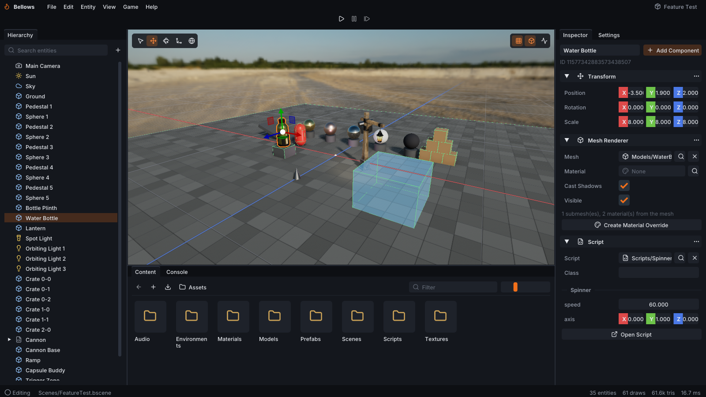

# MageCap Bellows

**A simple, modern 3D game engine for Windows and Linux** by MageCap Games. Physically based
rendering, real physics, Python scripting, one-click game export - and an editor that AI agents
can drive end to end.




## Features

* **Renderer** (Vulkan 1.3 via NVRHI): metallic/roughness PBR, image-based lighting from HDRIs
  (e.g. [Poly Haven](https://polyhaven.com/hdris)) or a procedural sky, cascaded soft shadows (PCSS),
  SSAO, HDR bloom, ACES/AgX tonemapping, FXAA, alpha blending and masking, glTF 2.0 models with
  their materials and textures.
* **Physics** (Jolt): static, dynamic and kinematic bodies; box, sphere, capsule, triangle-mesh and
  compound colliders; triggers; collision callbacks; raycasts.
* **Audio** (miniaudio): 2D and 3D sound sources, listener, one-shots.
* **Scripting** in Python 3: behavior scripts with lifecycle callbacks, Inspector-editable fields,
  entity creation/destruction, prefabs, input, physics and audio APIs.
  See [docs/ScriptingAPI.md](docs/ScriptingAPI.md).
* **Editor**: hierarchy, inspector, content browser with drag and drop, console with a Python
  prompt, transform gizmos, picking, undo/redo, play/pause/step, prefabs, render settings, project
  hub, and **Export Game** (a standalone build with its own Python runtime).
* **Automation**: everything in the editor is scriptable (`bellows.editor`), from the Console,
  from `--run-script`, or remotely through the local agent server - ask an AI agent to build a
  game and it can create, play-test, screenshot and export it.
  See [docs/EditorAutomation.md](docs/EditorAutomation.md).

## Building on Windows 11 (step by step)

You need about 6 GB of free disk space. Install these once:

1. **Visual Studio 2022** (Community is fine) from https://visualstudio.microsoft.com/downloads/.
   In the Visual Studio Installer, on the **Workloads** tab, tick **Desktop development with C++**,
   then click **Install**. This includes CMake.
2. **Vulkan SDK** from https://vulkan.lunarg.com/sdk/home#windows. Click the latest
   **SDK Installer** for Windows, run it and keep the default components. It provides the shader
   compiler the build uses. Restart your computer afterwards so the `VULKAN_SDK` variable is set.
3. **Python 3.13 (64-bit)** from https://www.python.org/downloads/windows/ ("Windows installer
   (64-bit)"). On the first installer page tick **Add python.exe to PATH**, then click
   **Install Now**.
4. **Git** from https://git-scm.com/download/win (or use GitHub Desktop, which includes Git).
5. An up-to-date **graphics driver** with Vulkan 1.3 support (Intel, AMD and NVIDIA drivers from the
   last few years all have it; on Intel UHD laptops use the latest driver from intel.com).

Get the code (the `--recursive` part also downloads the third-party libraries):

1. Open the **Start** menu, type `Developer PowerShell for VS 2022` and open it.
2. Go to the folder where you keep projects, for example: `cd C:\Dev`
3. Run: `git clone --recursive https://github.com/theviktan/magecap-bellows.git`
4. Run: `cd magecap-bellows`

   (If you cloned with GitHub Desktop instead, open this PowerShell in the repository folder and
   run `git submodule update --init --recursive` once.)

Build:

5. Run: `cmake --preset windows`
6. Run: `cmake --build build/windows --config Release`
7. Start the editor: `build\windows\bin\BellowsEditor.exe`

   You can also open `build\windows\MageCapBellows.sln` in Visual Studio, right-click
   **BellowsEditor** in Solution Explorer, choose **Set as Startup Project**, and press **F5**.

Run the tests: `ctest --test-dir build/windows -C Release --output-on-failure`

(Debug and Release builds share the `bin` folder; build with `--config Debug` when you want to debug the engine in Visual Studio.)

## Building on Linux (Ubuntu 24.04 or newer)

```bash
sudo apt install build-essential cmake ninja-build git python3-dev glslang-tools \
    libvulkan-dev mesa-vulkan-drivers libx11-dev libxrandr-dev libxinerama-dev \
    libxcursor-dev libxi-dev libwayland-dev libxkbcommon-dev
git clone --recursive https://github.com/theviktan/magecap-bellows.git
cd magecap-bellows
cmake --preset linux-release
cmake --build build/linux-release
./build/linux-release/bin/BellowsEditor
ctest --test-dir build/linux-release --output-on-failure
```

The engine needs Python 3.11 or newer with its development files (`python3-dev`); 3.13 is the
tested version.

## Your first game

1. Start the editor and click **New Project**, give it a name and a folder, click **Create**.
2. Use **Entity → 3D Object** to add shapes, select them in the viewport or the **Hierarchy**
   panel, and move them with the gizmo (**W** move, **E** rotate, **R** scale; hold **Ctrl** to snap).
   Fly around the viewport with the **right mouse button** held plus **W A S D**.
3. In the **Content** panel, right-click → **Python Script**, double-click it to edit, then drag it
   onto an entity's **Add Component → Script** field.
4. Press **Play** (Ctrl+P) to run the game in the editor, Stop to return to the unchanged scene.
5. **File → Save Scene** (Ctrl+S), then **File → Export Game...** to build a standalone game.

`Projects/FeatureTest` is a complete sample: open it with **Open Project** and press Play.

## Repository layout

| Folder | Contents |
|--------|----------|
| `Bellows/` | Engine (static library) and shaders |
| `BellowsEditor/` | Editor |
| `BellowsRuntime/` | Game runtime (exported games use it) |
| `BellowsTests/` | Unit, GPU and automation tests |
| `Python/bellows/` | The `bellows` Python package |
| `Projects/FeatureTest/` | Sample project that uses every feature and tests the scripting API |
| `Tools/` | Agent CLI and build tools |
| `docs/` | Scripting and automation reference |

Contributors (human or AI) should read [AGENTS.md](AGENTS.md) first.

## License notices

MageCap Bellows uses open-source libraries, fonts and CC0 assets; see
[ThirdPartyNotices.md](ThirdPartyNotices.md). Exported games include that file.
