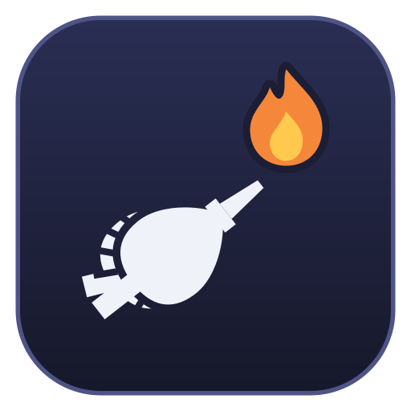
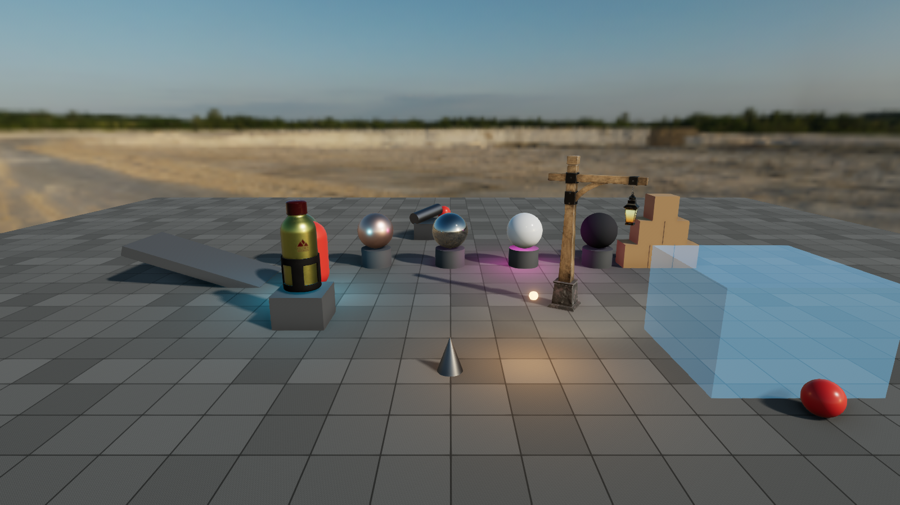

# MageCap Bellows

**A simple, modern 3D game engine for Windows and Linux** by MageCap Games. Physically based
rendering, real physics, Python scripting, one-click game export - and an editor that AI agents
can drive end to end.




## Features

* **Renderer** (Vulkan 1.3 via NVRHI): metallic/roughness PBR, image-based lighting from HDRIs
  (e.g. [Poly Haven](https://polyhaven.com/hdris)) or a procedural sky, cascaded soft shadows (PCSS),
  SSAO, HDR bloom, ACES/AgX tonemapping, FXAA, alpha blending and masking, glTF 2.0 models with
  their materials and textures.
* **Physics** (Jolt): static, dynamic and kinematic bodies; box, sphere, capsule, triangle-mesh and
  compound colliders; triggers; collision callbacks; raycasts.
* **Audio** (miniaudio): 2D and 3D sound sources, listener, one-shots.
* **Scripting** in **ForgeScript** or **Python 3**, with the same API in both: behavior scripts
  with lifecycle and physics events, Inspector-editable fields, entity creation/destruction,
  prefabs, input, physics and audio. See [docs/ScriptingAPI.md](docs/ScriptingAPI.md).
* **ForgeScript**: Bellows' own natural-language scripting language and its flagship way to write
  game logic (`set speed to 5`, `when collided with other`, `wait 2 seconds`). The language, its
  `forgescript` tool and its tests are in `ForgeScript/` (guide:
  [docs/ForgeScript/LanguageGuide.md](docs/ForgeScript/LanguageGuide.md)); what comes next is in
  [docs/Roadmap.md](docs/Roadmap.md).
* **Editor**: hierarchy, inspector, content browser with drag and drop, console with a Python
  prompt, transform gizmos, picking, undo/redo, play/pause/step, prefabs, render settings, project
  manager, and **Export Game** (a standalone build with its own Python runtime).
* **Project Manager** like Godot's: every project in one list with search, sorting, favorites,
  New Project templates, Import and Scan. Panels can be closed from their tab and brought back from
  **View → Panels**, docked anywhere by dragging their tab, and reset with **View → Reset Layout**;
  the Content panel has a folder tree.
* **Script Editor** built in, like Godot's: a **Scene / Script** switch in the toolbar, tabs for
  open scripts, ForgeScript and Python highlighting, an outline of functions and events, find and
  replace, completion, live error checking (the line turns red as you type), ForgeScript
  completion and hover help from the ForgeScript language server (engine functions, phrases and
  your own names, with signatures and docs; Ctrl+Space or "." to ask), and the ForgeScript
  guides one click away in **Help**. Attach scripts with right-click → **Attach Script...** in the
  Hierarchy or by dragging a script onto an entity.
* **ForgeScript debugger**: click left of a line (or press F9) to add a breakpoint, then play. When
  a script reaches it the game pauses, the Script Editor shows the line, and the **Debugger** panel
  shows the call stack and the variables of each call. Continue (F5), Step Over (F10), Step In
  (F11), Step Out (Shift+F11), or stop at the next line that runs. Breakpoints last for the editor
  session; saved scripts reload once the stopped script goes on.
* **Automation**: everything in the editor is scriptable (`bellows.editor`), from the Console,
  from `--run-script`, or remotely through the local agent server - ask an AI agent to build a
  game and it can create, play-test, screenshot and export it.
  See [docs/EditorAutomation.md](docs/EditorAutomation.md).

## Download (Windows)

You don't need to build the engine to use it. Releases are on the
[Releases page](https://github.com/theviktan/magecap-bellows/releases):

1. Open https://github.com/theviktan/magecap-bellows/releases and find the newest release
   (for example **MageCap Bellows 0.3.0**).
2. Under **Assets**, click **MageCap-Bellows-<version>-Windows.zip** to download it.
3. Right-click the downloaded zip, choose **Extract All...**, and extract it anywhere (for example
   `C:\MageCapBellows`).
4. Open the extracted folder and double-click **BellowsEditor.exe**. If Windows SmartScreen says
   "Windows protected your PC", click **More info** and then **Run anyway** (the editor is not
   code-signed yet).

To try changes made since the last release, take a build of `main`: open
https://github.com/theviktan/magecap-bellows/actions/workflows/ci.yml, click the newest run on
`main` with a green check mark, and download **MageCap-Bellows-<version>-<commit>-Windows** from
**Artifacts** (you need to be signed in to GitHub). The commit in the name, also shown in
**Help → About**, tells builds apart. Release notes are in [docs/ReleaseNotes](docs/ReleaseNotes).
The only requirement is a graphics driver with Vulkan 1.3 (any recent Intel, AMD or NVIDIA driver).

## Building on Windows 11 (step by step)

You need about 6 GB of free disk space. Install these once:

1. **Visual Studio 2022** (Community is fine) from https://visualstudio.microsoft.com/downloads/.
   In the Visual Studio Installer, on the **Workloads** tab, tick **Desktop development with C++**,
   then click **Install**. This includes CMake.
2. **Vulkan SDK** from https://vulkan.lunarg.com/sdk/home#windows. Click the latest
   **SDK Installer** for Windows, run it and keep the default components. It provides the shader
   compiler the build uses. Restart your computer afterwards so the `VULKAN_SDK` variable is set.
3. **Python 3.13 (64-bit)** from https://www.python.org/downloads/windows/ ("Windows installer
   (64-bit)"). On the first installer page tick **Add python.exe to PATH**, then click
   **Install Now**.
4. **Git** from https://git-scm.com/download/win (or use GitHub Desktop, which includes Git).
5. An up-to-date **graphics driver** with Vulkan 1.3 support (Intel, AMD and NVIDIA drivers from the
   last few years all have it; on Intel UHD laptops use the latest driver from intel.com).

Get the code (the `--recursive` part also downloads the third-party libraries):

1. Open the **Start** menu, type `Developer PowerShell for VS 2022` and open it.
2. Go to the folder where you keep projects, for example: `cd C:\Dev`
3. Run: `git clone --recursive https://github.com/theviktan/magecap-bellows.git`
4. Run: `cd magecap-bellows`

   (If you cloned with GitHub Desktop instead, open this PowerShell in the repository folder and
   run `git submodule update --init --recursive` once.)

Build:

5. Run: `cmake --preset windows`
6. Run: `cmake --build build/windows --config Release`
7. Start the editor: `build\windows\bin\BellowsEditor.exe`

   You can also open `build\windows\MageCapBellows.sln` in Visual Studio, right-click
   **BellowsEditor** in Solution Explorer, choose **Set as Startup Project**, and press **F5**.

Run the tests: `ctest --test-dir build/windows -C Release --output-on-failure`

(Debug and Release builds share the `bin` folder; build with `--config Debug` when you want to debug the engine in Visual Studio.)

## Building on Linux (Ubuntu 24.04 or newer)

```bash
sudo apt install build-essential cmake ninja-build git python3-dev glslang-tools \
    libvulkan-dev mesa-vulkan-drivers libx11-dev libxrandr-dev libxinerama-dev \
    libxcursor-dev libxi-dev libwayland-dev libxkbcommon-dev
git clone --recursive https://github.com/theviktan/magecap-bellows.git
cd magecap-bellows
cmake --preset linux-release
cmake --build build/linux-release
./build/linux-release/bin/BellowsEditor
ctest --test-dir build/linux-release --output-on-failure
```

The engine needs Python 3.11 or newer with its development files (`python3-dev`); 3.13 is the
tested version.

## Your first game

1. Start the editor. The **Project Manager** opens: click **New Project**, type a name, keep or
   change the location (**Browse...**), pick **3D Starter** and click **Create & Open**. Every
   project you open is listed there with search, sorting and favorites (the star); **Import** adds
   an existing `.bproject` and **Scan** finds all projects in a folder. Come back to it any time
   with **File → Project Manager...**.
2. Use **Entity → 3D Object** to add shapes, select them in the viewport or the **Hierarchy**
   panel, and move them with the gizmo (**W** move, **E** rotate, **R** scale; hold **Ctrl** to snap).
   Fly around the viewport with the **right mouse button** held plus **W A S D**.
3. Right-click an entity in the **Hierarchy** and choose **Attach Script...**. Pick **ForgeScript**
   or **Python**, keep the suggested path (for example `Scripts/Cube.forge`) and click **Create**.
   The new script opens in the **Script** workspace: type your code, press **Ctrl+S** to save, and
   click **Scene** in the top-left toolbar to go back to the 3D view. (You can also create scripts
   in the **Content** panel with right-click → **ForgeScript Script** / **Python Script**, and drag
   a script onto an entity in the Hierarchy to attach it.)
4. Press **Play** (Ctrl+P) to run the game in the editor, Stop to return to the unchanged scene.
5. **File → Save Scene** (Ctrl+S), then **File → Export Game...** to build a standalone game.

`Projects/FeatureTest` is a complete sample: open it with **Open Project** and press Play.

## Repository layout

| Folder | Contents |
|--------|----------|
| `Bellows/` | Engine (static library) and shaders |
| `BellowsEditor/` | Editor |
| `BellowsRuntime/` | Game runtime (exported games use it) |
| `BellowsTests/` | Unit, GPU and automation tests |
| `ForgeScript/` | The ForgeScript language: compiler, virtual machine, `forgescript` tool, tests |
| `Python/bellows/` | The `bellows` Python package |
| `Projects/FeatureTest/` | Sample project that uses every feature and tests the scripting API |
| `Tools/` | Agent CLI and build tools |
| `docs/` | Scripting, ForgeScript and automation reference |

Contributors (human or AI) should read [AGENTS.md](AGENTS.md) first. Plans for 2D, ForgeScript and
MageCap Forge integration are in [docs/Roadmap.md](docs/Roadmap.md).

## License notices

MageCap Bellows uses open-source libraries, fonts and CC0 assets; see
[ThirdPartyNotices.md](ThirdPartyNotices.md). Exported games include that file.
